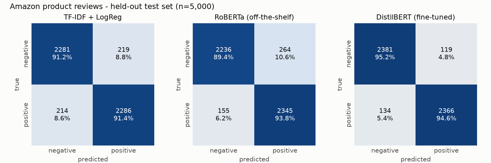

# Review Sentiment Analyzer

Paste a product or movie review and get its sentiment (positive / negative, plus neutral from a
second model) with confidence scores, see **which words drove the prediction**, and get
**aspect-level sentiment** (price, quality, delivery, acting, ...). Upload a CSV to analyze
thousands of reviews at once and download the results.

Under the hood it is a small, complete ML project: a **fine-tuned DistilBERT** transformer,
compared against an **off-the-shelf RoBERTa** model and a classic **TF-IDF + logistic regression**
baseline on held-out test sets, with a Gradio web app on top.

## Results at a glance

Held-out test sets, binary negative / positive (full report: [`results/results.md`](results/results.md)).

| Model | Amazon reviews (in-domain, n=5,000) accuracy / macro-F1 | IMDB movie reviews (cross-domain, n=2,000) accuracy / macro-F1 |
|---|---:|---:|
| TF-IDF + logistic regression | 0.913 / 0.913 | 0.874 / 0.874 |
| RoBERTa, off-the-shelf (tweets) | 0.916 / 0.916 | 0.811 / 0.811 |
| **DistilBERT, fine-tuned by us** | **0.949 / 0.949** | **0.905 / 0.905** |

Fine-tuning for 21 minutes on a laptop GPU cut the error rate on product reviews by
**~42%** versus the TF-IDF baseline (8.7% -> 5.1%) and by ~40% versus the off-the-shelf
transformer, and it transfers best to movie reviews it never saw.

---

## What's in the box

```
review-sentiment-analyzer/
├── sentiment/              # the Python package
│   ├── __init__.py         # paths + keeps caches/temp files inside the project folder
│   ├── data.py             # download & prepare Amazon / IMDB reviews, CSV column detection
│   ├── predict.py          # one interface for all three models
│   ├── explain.py          # word importance (occlusion) + aspect-level sentiment
│   ├── plots.py            # distribution chart and confusion matrices
│   └── gpu.py              # wait for free GPU memory (the GPU is shared)
├── baseline.py             # train TF-IDF + logistic regression
├── train.py                # fine-tune DistilBERT
├── evaluate.py             # compare all models -> results/
├── app.py                  # Gradio web app
├── examples/sample_reviews.csv
├── results/                # metrics, tables and confusion-matrix images
└── tests/                  # pytest tests
```

## How it works (in plain words)

**Sentiment analysis** = reading a piece of text and deciding whether the writer is happy or
unhappy. Computers can't read, so we need a model that turns text into numbers and numbers into
a decision.

**1. The classic baseline - TF-IDF + logistic regression.** Count which words (and word pairs)
appear in a review, weight rare-but-telling words higher (that's TF-IDF), and let a linear model
learn a weight per word: "excellent" +5, "waste of money" -6, ... It's fast and surprisingly
good, but it has no idea about word order or context: "not bad at all" looks like "bad".

**2. Transformers.** A transformer (BERT, RoBERTa, DistilBERT, GPT...) reads the whole sentence
at once and, through a mechanism called *self-attention*, lets every word look at every other
word to build a context-aware representation. "bad" next to "not ... at all" ends up meaning
something different from "bad" on its own. These models are first **pre-trained** on huge
amounts of text (e.g. all of Wikipedia + books) just by predicting missing words, which teaches
them grammar, meaning and a lot of world knowledge.

**3. Fine-tuning.** A pre-trained model knows English but not our task. Fine-tuning adds a tiny
new layer on top (here: 2 outputs, *negative* and *positive*) and continues training the
**whole** network for a short while on labelled examples - 60,000 Amazon reviews, two passes.
Because the model already understands language, this takes ~20 minutes on a laptop GPU instead
of weeks. We use **DistilBERT**, a smaller, 60% faster version of BERT that keeps ~97% of its
accuracy.

**4. Off-the-shelf model.** For comparison we also use
[`cardiffnlp/twitter-roberta-base-sentiment-latest`](https://huggingface.co/cardiffnlp/twitter-roberta-base-sentiment-latest),
a RoBERTa model someone else fine-tuned on ~124M tweets for negative / neutral / positive. It's
the "just download a model" option. It also gives us a *neutral* class in the app.

**5. Fair evaluation.** All models are scored on reviews **none of them saw during training**:
5,000 reviews from the official Amazon test split (same domain as training) and 2,000 IMDB movie
reviews (a *different* domain - tests whether the model generalizes). We report **accuracy**
(share of correct answers) and **macro-F1** (the average F1 of the two classes, which punishes a
model that is good at only one class).

**6. Explanations.**
- *Word importance (occlusion):* remove one word (or chunk) at a time and measure how much the
  model's confidence drops. The words whose removal hurts most are the ones driving the decision.
- *Aspect-level sentiment:* split the review into sentences (also before "but"), tag each sentence
  with the aspects it mentions using a keyword list (price, quality, delivery, customer service,
  acting, plot, ...) and score each sentence separately. "Great quality but shipping took
  forever" becomes quality = positive, delivery = negative.

## How to run

Requires Python 3.12 and (optionally) an NVIDIA GPU. Everything the project downloads (models,
datasets) goes into `.hf_cache/` inside the project folder.

```bash
py -3.12 -m venv .venv
```

```bash
.venv\Scripts\activate
```

```bash
pip install torch --index-url https://download.pytorch.org/whl/cu126
```

```bash
pip install -r requirements.txt
```

Then, in order:

```bash
python baseline.py     # ~1 min: TF-IDF + logistic regression (downloads ~380 MB of Amazon reviews)
```

```bash
python train.py        # ~15-20 min on a laptop GPU: fine-tune DistilBERT -> models/distilbert-sentiment/
```

```bash
python evaluate.py     # ~2 min: compare all three models -> results/
```

```bash
python app.py          # open http://127.0.0.1:7860
```

```bash
pytest                 # fast unit tests; model tests are skipped until the models are trained
```

Quick try without the full training run: `python train.py --n-train 10000 --epochs 1`.

## Results

See [`results/results.md`](results/results.md) for the full report and
[`results/top_words.md`](results/top_words.md) for what the TF-IDF baseline learned.



What the numbers say:
- **Fine-tuning matters more than model size.** The off-the-shelf RoBERTa is a *bigger* model than
  DistilBERT, but it was trained on tweets; on product reviews it barely beats TF-IDF, and on
  long movie reviews it is the worst of the three. A smaller model trained on the right data wins.
- **The classic baseline is strong and ~20x faster.** 91% accuracy in 15 seconds of training. Always
  build one - it tells you how much the transformer actually adds.
- **Where the errors go.** DistilBERT and TF-IDF make about as many mistakes on each class; the
  off-the-shelf RoBERTa leans positive (it calls 10.6% of negative reviews positive vs 6.2% the
  other way), another symptom of the domain mismatch.

### Known limitations

- The fine-tuned model only knows *negative* and *positive* (Amazon Polarity has no 3-star reviews);
  the app shows the RoBERTa model's *neutral* score next to it for mixed or flat reviews.
- Subtle phrasing is still hard: "Not bad at all, I expected much worse for this price" comes out as
  a ~50/50 call, while the shorter "Not bad at all, I expected much worse." is correctly positive.
- Aspect tagging uses a keyword list, so it misses aspects described without those words and can
  mis-tag words with two meanings (e.g. "score").
- Reviews longer than 256 tokens (~190 words) are truncated.

## Ideas for next steps

- Train on more data (all 3.6M Amazon reviews) or a bigger model (RoBERTa-base, DeBERTa-v3).
- Add a real neutral class (e.g. 3-star reviews from Amazon Reviews 2023).
- Replace keyword aspect tagging with zero-shot classification or a dedicated aspect-based
  sentiment model.
- Export to ONNX / quantize for faster CPU inference; deploy the app to Hugging Face Spaces.

## Resume bullet suggestions

- Fine-tuned a **DistilBERT** transformer (Hugging Face Transformers, PyTorch, mixed-precision fp16)
  on 60k Amazon reviews for sentiment classification, reaching **94.9% accuracy / 0.949 macro-F1** on
  a held-out test set and cutting errors by **~42%** versus a TF-IDF + logistic-regression baseline.
- Benchmarked fine-tuned, off-the-shelf (Twitter-RoBERTa) and classical models on in-domain and
  cross-domain (IMDB) test sets; showed domain-matched fine-tuning beats a larger pretrained model
  (**90.5% vs 81.1%** on unseen movie reviews).
- Built a **Gradio** web app with single-review and CSV batch analysis, occlusion-based word
  importance and aspect-level sentiment (price, quality, delivery, ...), backed by a pytest suite.
- Engineered GPU-sharing-aware training (free-memory checks, automatic OOM retry with gradient
  accumulation) to train on a 6 GB laptop GPU alongside other jobs.
