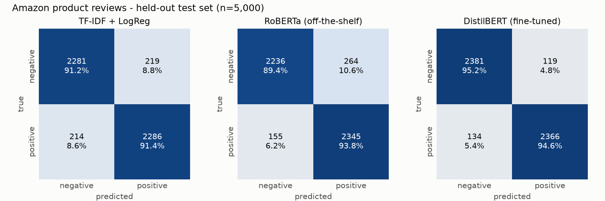
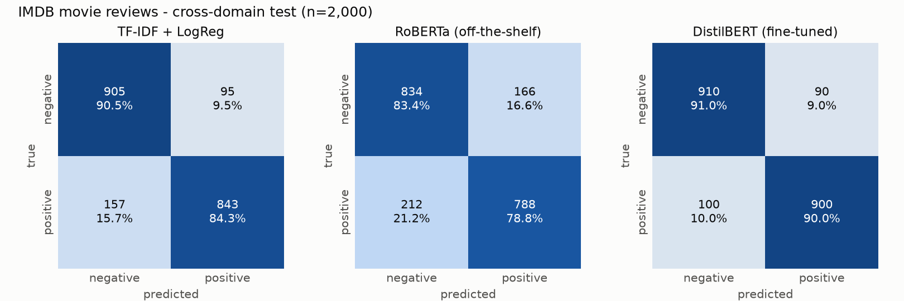

# Results

All numbers are on reviews **no model saw during training**. Binary task: negative vs positive.
The off-the-shelf RoBERTa predicts 3 classes; it is scored by comparing P(positive) with P(negative).

DistilBERT was fine-tuned on 60,000 Amazon reviews for 2 epochs (batch 16, max length 256 tokens, fp16) in 20.7 minutes on an RTX 4050 laptop GPU.

## Amazon product reviews (in-domain, n = 5,000)

| Model | Accuracy | Macro-F1 | Speed (reviews/s) |
|---|---:|---:|---:|
| TF-IDF + LogReg | 0.9134 | 0.9134 | 5,105 |
| RoBERTa (off-the-shelf) | 0.9162 | 0.9162 | 165 |
| DistilBERT (fine-tuned) | 0.9494 | 0.9494 | 230 |

## IMDB movie reviews (cross-domain, n = 2,000)

None of the models were trained on movie reviews; this shows how well each one transfers.

| Model | Accuracy | Macro-F1 | Speed (reviews/s) |
|---|---:|---:|---:|
| TF-IDF + LogReg | 0.8740 | 0.8739 | 1,744 |
| RoBERTa (off-the-shelf) | 0.8110 | 0.8109 | 122 |
| DistilBERT (fine-tuned) | 0.9050 | 0.9050 | 151 |

## Notes

- Off-the-shelf model: `cardiffnlp/twitter-roberta-base-sentiment-latest` (trained on tweets). On the Amazon test set its top prediction was *neutral* for 6.6% of reviews, even though every review is clearly 1-2 or 4-5 stars - a sign of domain mismatch (tweets vs. product reviews). It also does worst on IMDB, whose long movie reviews (often 300+ words, truncated to 256 tokens) look nothing like tweets.
- Speed is measured on the shared laptop GPU (transformers, fp16, batch 32) and CPU (TF-IDF); treat it as a rough comparison.
- See `top_words.md` for the words the TF-IDF baseline relies on.
